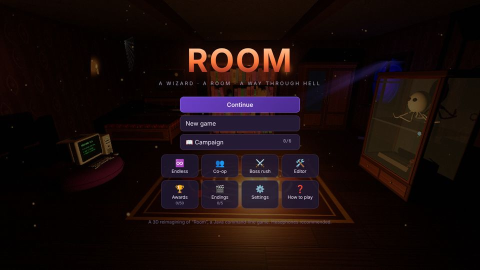
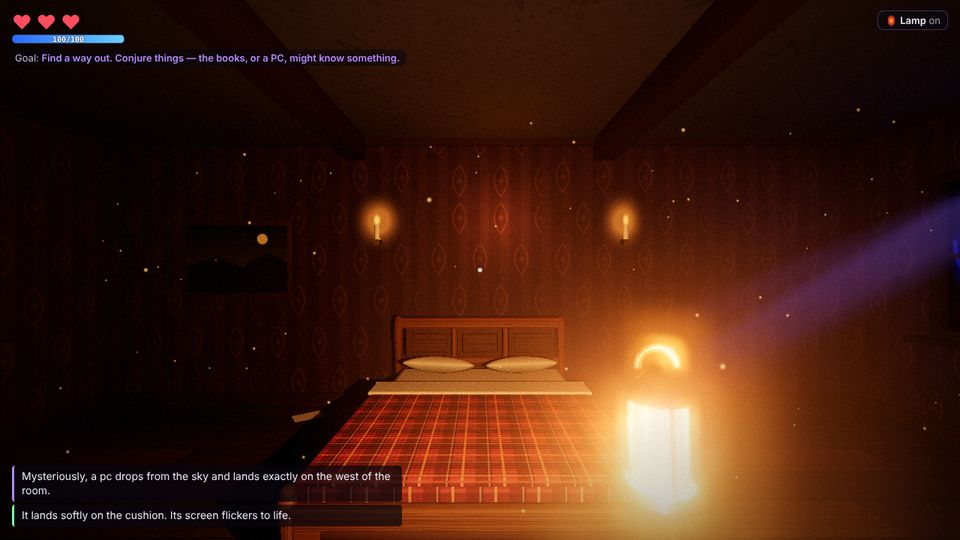
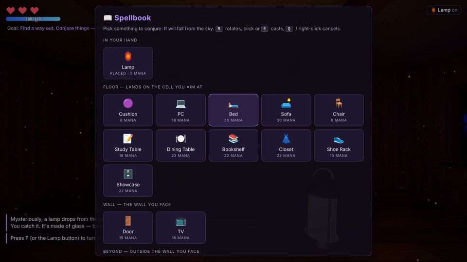
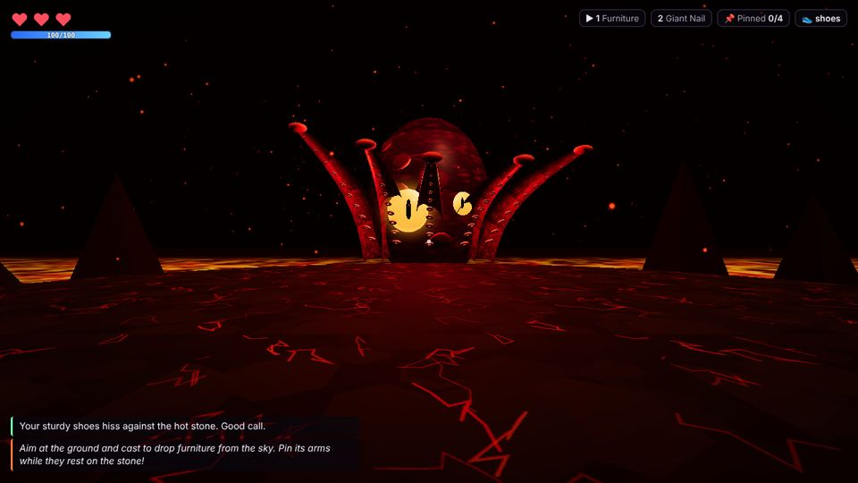
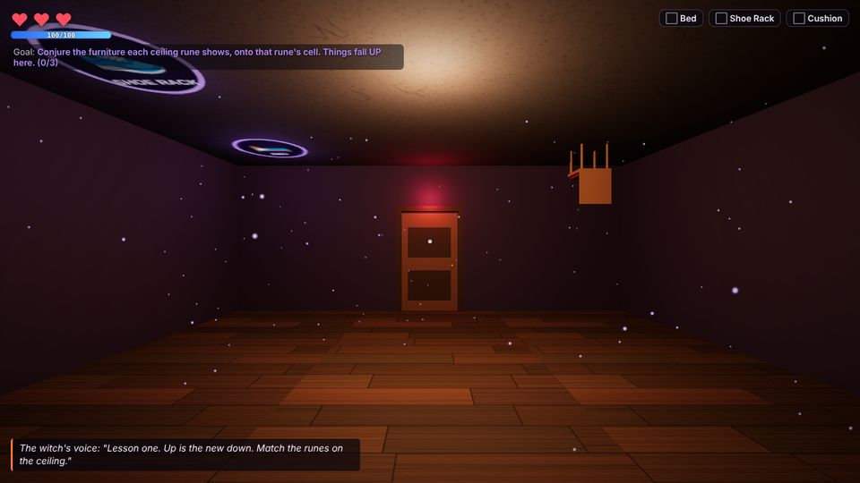
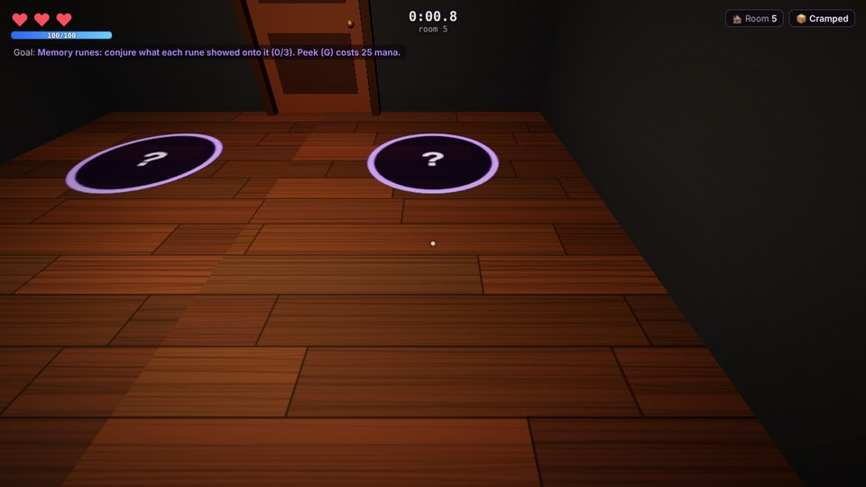

# ROOM — a 3D reimagining

A first-person 3D browser remake of **Room**, the original Java command-line game in
[`../Create a Room-20220730T174306Z-001`](../Create%20a%20Room-20220730T174306Z-001) (left untouched).

> You, a newbie wizard, lost a duel to the best witch in your world. She banished you to a room
> beyond hell. To get back to the world of the living you will literally need to go through hell.
> The good news: you kept your powers. Anything you conjure **falls from the sky**.

## Run it

```bash
cd web3d
npm install
npm run dev        # http://localhost:5173
npm run build      # static site in dist/ (works from any sub-path, e.g. GitHub Pages)
```

Built with [three.js](https://threejs.org), TypeScript and Vite. There are no asset files: every texture, model and
sound is generated in code (canvas textures, primitive geometry, WebAudio synthesis).

## Screenshots

| | |
|---|---|
|  |  |
|  |  |
|  |  |

## How it plays

**Act 1 — The Room.** You start in total darkness, too scared to move. Open the spellbook and conjure
furniture onto a 3×3 grid, doors and TVs onto walls, and whole rooms (bathroom, kitchen, Hell) beyond the
walls. The original puzzle chain is still here, expanded:

1. Conjure a lamp and turn it on so you can move.
2. A PC shatters on the bare floor. Conjure a cushion first, then drop the PC onto it.
3. Beat the PC at rock-paper-scissors. Its secret tip: search the floor where it stands.
4. The invisible key opens the glass showcase: a Kraken skeleton, a fossil of a giant nail (which teaches
   you the **Giant Nail** spell) and a key with an **H** on it.
5. Conjure Hell beyond a wall and a door on that wall. The door beside Hell locks itself until you have the H key.
6. Wear shoes. ("Please wear shoes before going out of the house.")

Optional side content: six readable books full of lore and hints, a dream when you sleep, the witch's TV
channel (sit on a chair facing the TV), a working bathroom (you can't leave with the tap running), a kitchen
with one ember stew (+1 max heart, eaten at the dining table), a closet mirror, and more.

**Act 2 — Hell.** The "to be continued" from the original is now a boss fight against **KRAKEN 2.0**. Its
arms slam where you stand and then rest on the stone. Drop your conjured furniture on them to pin them.
Pin four and its head slumps forward. Then drop the Giant Nail on it.

**Act 3 — The Rematch.** After escaping, the witch offers a rematch in her garden. She lands on standing
stones to cast falling pumpkins and cauldrons. Drop furniture on her while she's grounded. In phase 2 she
splits into mirror clones (only the real witch casts a shadow). In phase 3 her shield reflects drops back at
you. The judgmental lemon from the fridge is her secret weakness.

**Secrets.** A crooked book in the shelf (Ember Wand: faster casting), a hollow panel in the closet
(Witch's Cloak: absorbs one hit per boss), a vault on the PC whose code is hidden in the witch's TV
broadcast (her diary), and the lemon. An anvil (physics junk) dropped on the showcase smashes it: an
alternate route to the H key.

**Modes.** Normal, Hard (one heart, a five-pin Kraken), and a date-seeded Daily room (pre-built furniture,
key hidden in a random cell). There's a speedrun timer with splits against your personal best.

**Endings.** Five of them: decline the rematch, help the witch up, steal her broom, the true ending (every
secret + every book), and a secret one for players who just... stay and redecorate. An endings gallery tracks them.

**Part 4 — The Three Lessons** (after a witch ending): the Upside-Down Room (everything falls *up*; match the
ceiling runes), the Flooded Library (rising water floats you; conjured furniture displaces water; save six books
before they sink) and the Clockwork Tower (the room turns; jam the gear when the door faces the bridge).

**Campaign.** A chapter map to replay any chapter you've reached, letterboxed cutscenes, a pre-fight
conversation with the witch whose answers change the fight, crystal-ball hints in the lessons, and optional
read-aloud narration.

**Mana and spells.** Conjuring costs mana from a regenerating pool. Learn Levitate (move furniture), Shrink
(tiny for 10 s — there's a secret under the bed) and Blink (teleport) through side content.

**Endless rooms.** A roguelike mode: procedurally generated rooms (floor runes, upside-down runes, memory runes, key hunts,
pressure plates), upgrades between rooms, one life, a local leaderboard and a date-seeded daily run.

**Co-op.** Two players, peer-to-peer over WebRTC with copy-paste invite codes — no server. Solve the Twin Room
together: match the runes, then both stand on opposite pressure plates.

**Photo mode** (V): freeze the game, fly the camera, apply film filters, save a PNG.

**Room editor.** Build your own escape room, hide the key in a piece of furniture, pick an exit door, add a
title and note, test it, and share it as a link. The whole room is encoded in the URL, so no server is needed.

## Controls

| Desktop | Touch | Action |
|---|---|---|
| WASD / arrows, Shift to run | left stick | move |
| mouse (click to capture) | drag | look |
| E | Use | interact / confirm |
| Q | Spells | spellbook (in Hell: switch spell) |
| click | Cast | conjure / attack |
| R | Use (while placing) | rotate before conjuring |
| F | Lamp | lamp on/off |
| G | Search | search the floor |
| X | — | put the lamp down |
| Space | move | stand up |
| Esc | II | pause |
| / or T | Pause → Command line | classic CLI: `create bed north east`, `go sw`, `locate`, `turn lamp`… |
| 1 / 2 / 3 / 4 | Spells / Search | in boss fights: furniture, nail or lemon, Blink, Shrink |
| V | Pause → Photo mode | photo mode |

A gamepad works too: left stick move, right stick look, A use, RT cast, Y spells, X lamp, LB search, LT rotate,
B stand/cancel, Start pause; the d-pad and A navigate menus.

## Features

- Autosave, with checkpoints at the gate of Hell and at the start of the rematch; Continue from the title screen
- 47 achievements, stored in the browser
- Real physics (Rapier, loaded on first use): junk spells (crate, beach ball, anvil) that stack and tumble;
  furniture that misses in Hell tumbles, gets blasted by slams and can roll into the lava
- Installable PWA with offline play (production build), gamepad support
- Procedural music and sound: ambient drones, a heartbeat in the dark, a music box, Hell war drums,
  and synthesised sound effects
- Settings: music/sfx volume, look sensitivity, invert Y, graphics quality (shadows + bloom), auto resolution,
  FPS counter, speedrun timer
- Accessibility: remappable keys, sound captions, reduced motion, colour-blind safe telegraphs, text size,
  optional narration
- Dynamic music that reacts to danger; surface-aware footsteps
- Adaptive resolution and instanced rendering for phones
- Touch controls are switched on automatically on phones and tablets

## Code map

| File | What |
|---|---|
| `src/main.ts` | renderer, game loop, every screen and mode (campaign, endless, co-op, editor, photo, cutscenes) |
| `src/game.ts` + `src/roomlevel/*.ts` | Act 1: state and frame update; placement, interactions, physics, console, search |
| `src/hell.ts` | Act 2: arena, Kraken 2.0, tentacle AI, pins, fireballs, nail, victory |
| `src/witch.ts` | Act 3: the witch's garden, witch AI, clones, reflection, lemon |
| `src/physics.ts` | lazy-loaded Rapier wrapper |
| `src/share.ts` | URL encoding of custom rooms |
| `src/tube.ts` | tapered tube geometry for tentacles |
| `src/bosslevel.ts` | shared boss-fight pieces (markers, ammo, cloak) |
| `src/chamber.ts`, `src/lessons.ts` | Part 4 base level and the three lessons |
| `src/roguelike.ts` | endless mode rooms and upgrades |
| `src/coop.ts`, `src/net.ts` | co-op level and WebRTC peer |
| `src/endings.ts`, `src/state.ts` | endings registry; fresh state and the daily seed |
| `src/spells.ts`, `src/dialogue.ts`, `src/cutscene.ts`, `src/voice.ts`, `src/photo.ts`, `src/a11y.ts` | spells and mana; dialogue trees; cutscenes; narration; photo mode; accessibility |
| `src/room.ts` | room geometry, the 3×3 grid, walls with door gaps, annex rooms |
| `src/models.ts` | procedural furniture, keys, lantern, giant nail; the conjure catalog |
| `src/story.ts` | all narrative text |
| `src/audio.ts` | WebAudio synthesis |
| `src/input.ts`, `src/player.ts` | keyboard/mouse/touch input, first-person controller |
| `src/ui.ts`, `src/style.css` | HUD, dialogs, toasts, screens |
| `src/save.ts` | save game, settings, achievements |

`window.__room` exposes the engine for automated playtests.

## Tests

```bash
npm run typecheck   # tsc
npm run test:unit   # Vitest: state/daily seed, share codec, mana, bests, achievements
npm run test:e2e    # Playwright: builds, serves on :4173, runs the browser suite
npm test            # both
```

Visual regression snapshots live in `tests/visual.spec.js-snapshots/` (frozen time, seeded randomness).
Update them deliberately with `npx playwright test visual --update-snapshots`. `tests/perf.spec.js` enforces a
bundle-size and draw-call budget.

The suite covers the title screen, the Act 1 puzzle chain, the command line, the secrets, both boss fights,
physics (the anvil smash) and the editor's share-and-play round trip. It drives the game through
`window.__room` because software WebGL renders slowly. CI runs it on every push that touches `web3d/`
(`.github/workflows/web3d-tests.yml`).
